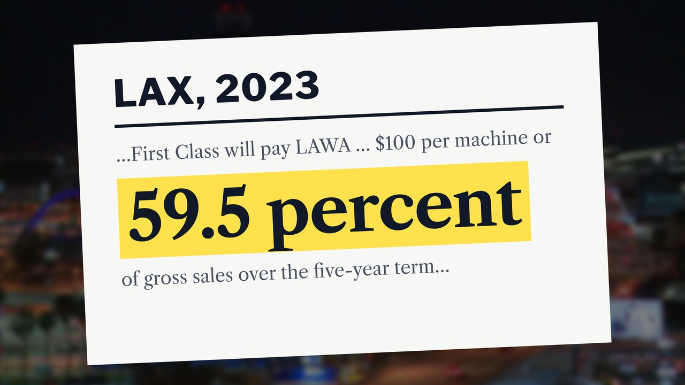

# Episode 1 thumbnails and the test to run

**A2 (use this): A with a real vending machine** (bottles in numbered spirals) instead of the soda can. The top faceless explainers always show their subject: Modern MBA's money videos show the pizza, the boba or the steak. A showed a can, which could have come from anywhere. **A: "62¢" with The Split.** A real soda can, the $2 cut into colored slices, and the owner's slice boxed in yellow. **B: the LAX contract.** The real contract wording, with "59.5 percent" highlighted.

Upload the **4K files** (3840×2160): `A-62c-owner-4k.jpg`, `B-lax-59-5-percent-4k.jpg`. YouTube now takes 4K thumbnails, and they stay sharp on a TV. The 1280 versions are a backup.

## The test to run

**First: "Thumbnail only", A vs B, with the main title fixed.**
1. Before you upload, verify the channel in Studio → Settings → Channel → Feature eligibility. Test & Compare needs **advanced features**, which come from ID or video verification. Phone verification isn't enough.
2. Publish with the title "LAX Takes 59.5% of Every Vending Machine Sale" and **thumbnail A2** as the default. If the test is inconclusive, YouTube keeps the first one uploaded, and A is the stronger guess.
3. In desktop Studio, open the video → Test & Compare → **Thumbnail only** → add B. Use only two options: a new channel's first video gets few impressions, and three options split them further.
4. Leave it alone for up to 14 days. **Any edit to the title or thumbnail stops the test.**
5. YouTube picks the winner by **watch time share**, not clicks. "Inconclusive" is normal for a first video, because telling apart a 4% and a 5% click rate takes about 6,700 impressions per option. If that happens, keep A and try a bolder idea on Episode 2.

**Second, after a winner: "Title only", with the winning thumbnail fixed.** Test the main title against "A Vending Machine Can Take 14 Years to Pay Off".

Don't use "Title and thumbnail" mode. It changes both at once, so you can't tell which one made the difference.

## Why these two

**What wins, from 75 real thumbnails:**
- In vending, 24 of the top 25 show an owner's face beside a bright machine, cash, arrows and "$/MONTH" banners. The faceless vending videos topped out around 100K views.
- The big faceless channels win without a face. They show **one familiar object with the data on it**, for example Modern MBA's steak cut into "$ / $$ / $$$" slices (3.4M views). A is that idea, done with our own Split.
- With 40–65 viewers, the biggest outliers use a **real labelled figure with a highlight or circle**. B is that idea, done with our Deal File.
- The overused looks in vending, which we avoid, are faces in front of snack walls, cash with arrows, and warning-red "DO NOT" theatre.

**Principles, with the strongest evidence first:**
1. **Few words.** The best thumbnails have no text, or under 10 characters ([1of10](https://1of10.com/blog/what-actually-makes-a-youtube-video-go-viral-in-2025)). A's headline is "62¢" and B's is "59.5 percent".
2. **Don't repeat the title.** Only 4% of top videos do ([study](https://www.overseeros.com/blog/youtube-thumbnail-text-vs-title-study)). The title gives the airport's 59.5%, and thumbnail A2 shows the owner's 62¢, so the two don't repeat. With this title, don't use B, because it shows the same 59.5%.
3. **Faces are optional.** Business videos did worse with them ([1of10](https://1of10.com/blog/what-actually-makes-a-youtube-video-go-viral-in-2025), [SEJ](https://www.searchenginejournal.com/do-faces-help-youtube-thumbnails-heres-what-the-data-says/563944/)).
4. **A bright subject on a dark ground.** Contrast is what survives shrinking ([vidIQ](https://vidiq.com/research/youtube-thumbnail-study/)). Navy keeps the brand, and the bright white number and yellow highlight carry the eye.
5. **Design it as a TV poster.** TV is YouTube's top US screen. YouTube says to keep thumbnails "clean, balanced and easy to read" ([YouTube](https://blog.youtube/creator-and-artist-stories/tv-tips/)). Both were checked at phone size (shown below the full size in my review).
6. **One focal point.** "Try not to make the design too complex" ([YouTube Help](https://support.google.com/youtube/answer/12340300)).
7. **Older eyes need big, high-contrast type and no clutter** ([NN/g](https://www.nngroup.com/articles/usability-for-senior-citizens/)).

**Honesty.** Everything shown is in the video: the 62¢ Split, and the LAX contract quoted word for word ("First Class will pay LAWA … 59.5 percent of gross sales over the five-year term"). Thumbnails that mislead can get a strike ([YouTube](https://support.google.com/youtube/answer/9229980)).

Full research with every source: `research/ep1-packaging/thumbs-competitors.md` and `thumbs-principles.md`.
